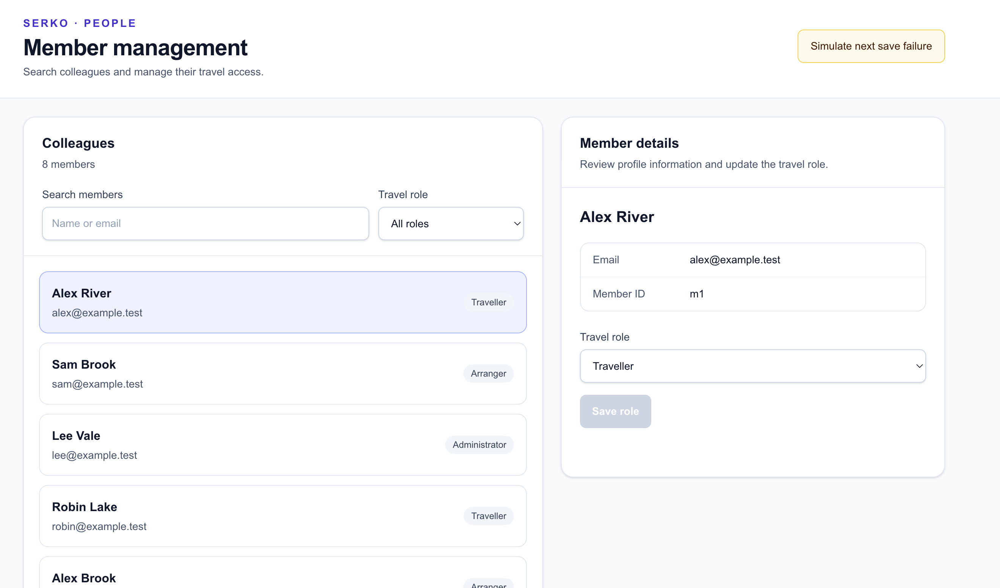
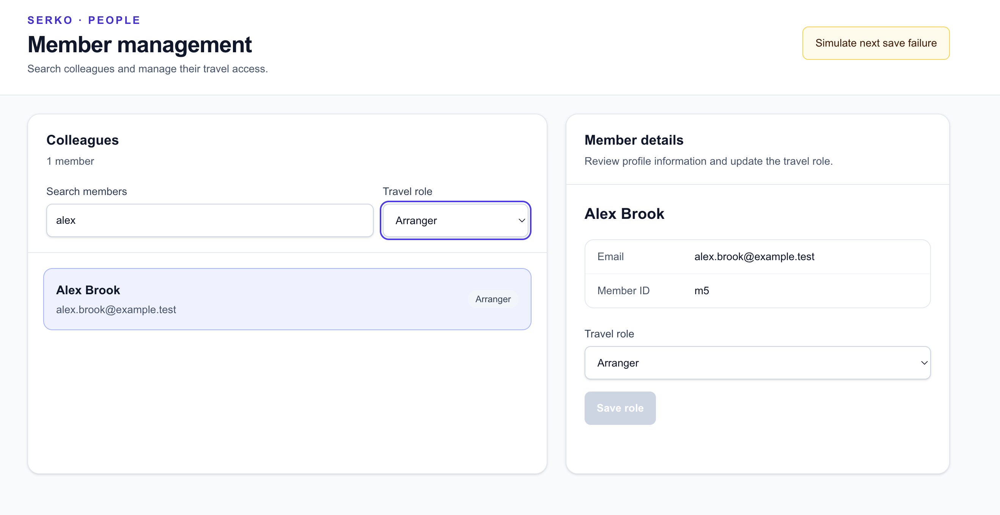
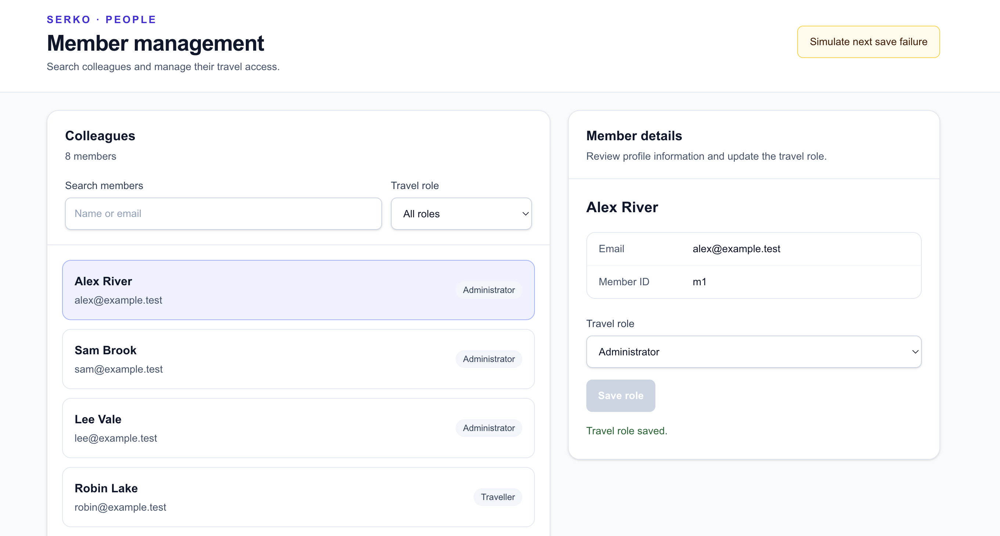
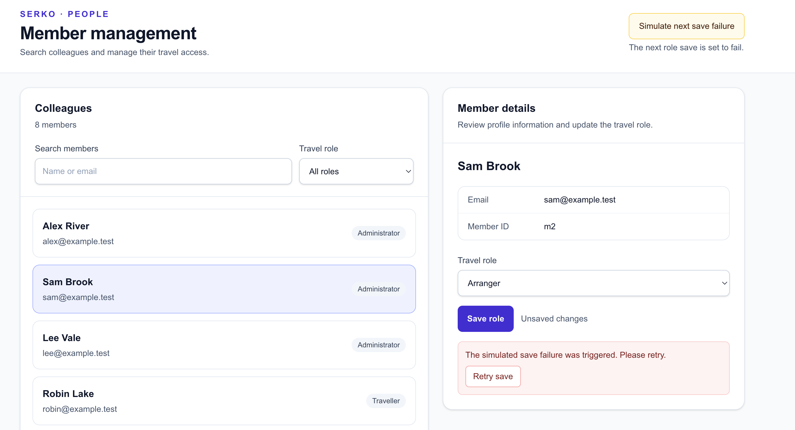
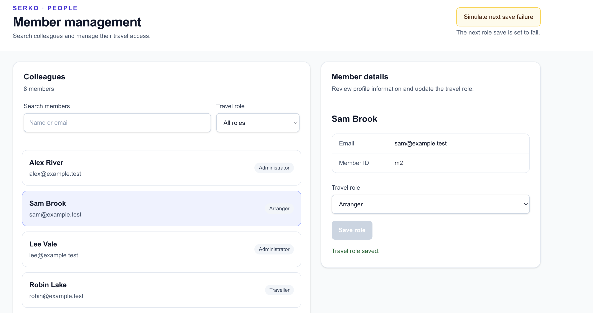

# Implementation approach

## Requirements interpretation

This is a small local member-management application, not a production identity or authorization system. The backend starts with the eight fixed synthetic members specified in [AGENTS.md](./AGENTS.md) and keeps them in an in-memory store. A member's travel role is data; it does not authenticate a user or grant access to the application.

Search is a case-insensitive partial match against first name, last name, or email. Role filtering accepts the exact canonical role values `traveller`, `arranger`, and `administrator`; when both search and role are supplied, both conditions must match.

## Contract-first API

[openapi.yaml](./openapi.yaml) is the source of truth for routes, request and response schemas, role values, and documented status codes. The API implementation and frontend client align with it:

- `GET /api/members` returns an object containing `items`.
- `GET /api/members/{id}` returns a `Member`.
- `PATCH /api/members/{id}` accepts only a role update and returns the updated `Member`.
- `POST /api/dev/fail-next-save` arms a Development-only one-shot save failure.
- Errors use `{ "error": { "code": "...", "message": "..." } }`.

The frontend types model the documented member fields and role union. The API client encodes query values and member IDs, retains HTTP status and API error details in its typed error, and lets network errors propagate.

The backend seeds the required records in `InMemoryMemberStore`. Store operations are synchronized with a lock, including consuming the one-shot failure flag. On a valid role update, the simulated failure is consumed before mutation. The development endpoint returns HTTP 404 outside Development.

## Frontend state and selection

The frontend keeps server-loaded member results separate from the selected role draft. Search is debounced by 250 ms, and search and role values are sent together. While results are refreshing, the existing list stays visible with an “Updating results…” status; selection and role saving are blocked to prevent acting on possibly stale results. If a refresh fails after results have loaded, the previous results remain visible and the UI offers a retry.

When a list response is accepted, the current selection is kept if that member remains in the results. Otherwise, the first result is selected; an empty result clears the selection and detail panel. Request sequence IDs prevent stale list responses from replacing newer results. After a successful save, the list is fetched again using current filters and selection is reconciled against that response.

The details panel derives the selected member from the current selected ID and result list rather than issuing a separate detail request during member switching. A failed save does not replace the draft role, so retrying submits the same selection. Manually switching members with unsaved edits requires confirmation. If a filter would remove an unsaved selected member, the same confirmation is presented; declining restores the previously applied filters.

## Error handling and simulated failure

The API client raises a typed error for non-2xx responses, retaining the HTTP status and API error code/message when present. It does not turn network failures into success-shaped responses.

The UI includes initial loading and load-error states, empty results, save-in-progress feedback, save success feedback, and a recoverable save error with a retry action. The development-only control calls `failNextSave()`. When the simulated HTTP 503 occurs, the selected role remains an unsaved draft; after the one-shot failure is consumed, the user can retry.

If a role update succeeds but the subsequent member-list refresh fails, the page keeps the successful update visible and reports that the list could not be refreshed, with a separate retry action.

## Test strategy and observed coverage

The backend test project uses xUnit and ASP.NET Core integration testing. Each integration test constructs its own application factory and fresh in-memory store. The existing backend integration tests cover:

- Eight seeded members.
- Case-insensitive name and email search.
- Role filter and combined search/role filter behavior.
- Invalid role filters return HTTP 400 with the documented API error code and message.
- Invalid PATCH role values and extra fields return HTTP 400.
- Empty `{}` and `{"role":null}` PATCH requests return HTTP 400 with the documented `INVALID_ROLE` code and message.
- Unknown member lookups and updates.
- Successful role updates.
- The one-shot simulated failure, ensuring the member does not mutate on failure, followed by a successful retry.
- The development failure endpoint returning HTTP 404 outside Development.

There is no dedicated test for concurrent consumption of the failure flag or for CORS behavior.

The frontend uses Vitest and React Testing Library:

- API-client tests mock `fetch` and cover list requests, combined query encoding, PATCH payloads, API error details, network error propagation, and the development failure endpoint.
- Component tests render the real page with the API client mocked. They cover initial load, combined search and role filtering, successful save, and preservation of an unsaved role after failure followed by retry.
- Hook tests directly exercise pure selection/detail helper functions. They cover post-save selection, filtered-result reconciliation, empty results, and resolving the current selected member. These are helper tests, not rendered-hook tests; they do not simulate actual asynchronous hook transitions.

No automated accessibility audit is currently included.

## Accessibility and responsive layout

The page uses semantic sections, headings, lists, forms, associated labels, native buttons and selects, visible focus styles, and live status and error regions. Member rows are buttons and can be navigated with the keyboard. Loading and saving status is exposed to assistive technology.

Manual keyboard checks covered navigation through search, role filtering, colleague selection, role editing, and saving, including visible focus indicators. Focus loss after saving was identified and addressed: focus moves to the success message if the saved member remains selected, or to the search input if that member is removed from the filtered results. The no-results state was also checked with a search that returned no matches.

Tailwind responsive classes provide a desktop list/details layout and allow member entries to stack at narrower widths. A narrow-screen check confirmed that the colleagues and details panels stack vertically. This is a responsive baseline only: mobile UX improvements were deferred, and the mobile layout has not been fully optimized.

No automated accessibility audit was performed.

## AI assistance and independent review

GitHub Copilot was used iteratively to assist with the API foundation, backend endpoints and integration tests, the member-management UI, and targeted selection and error-handling changes. Representative prompts and interactions included:

- Read the repository instructions and OpenAPI contract before proposing or implementing backend changes.
- Implement a typed frontend API client with mocked-fetch tests based on the contract.
- Reconcile the selected member after filter changes and successful role updates.
- Keep previous list results visible while refreshing and avoid actions against stale results.
- Add focused tests for combined filters and malformed role-update requests.
- Draft project README and approach documentation based on inspected repository implementation.

The submitter reviewed the repository instructions and API contract, inspected implementation and test changes, and raised mismatches found during that review, including correcting the seed data and identifying selection/filter synchronization problems. Build, lint, and test commands were run at different points in the implementation and their observed results were reported at those times. This document does not claim that additional commands were run for its preparation.

## Trade-offs, omissions, and future improvements

The in-memory store and minimal API keep the exercise small and make integration tests isolated, but provide neither persistence nor multi-instance coordination. The failure flag is process-local and intended only for Development.

The frontend uses native controls and local React state without adding a state-management dependency. Authentication, authorization, pagination, production hosting configuration, and a complete mobile usability pass are outside the current implementation. Possible follow-up work includes rendered-hook tests for asynchronous state transitions, a dedicated CORS test, a more thorough mobile review, and persistent evidence artifacts for the main journey and failure/retry demonstration.

## Evidence

The following screenshots demonstrate the main application journeys and error-handling behaviour.

### Initial application

### Combined search and role filtering

### Successful role update

### Simulated save failure

### Successful retry

